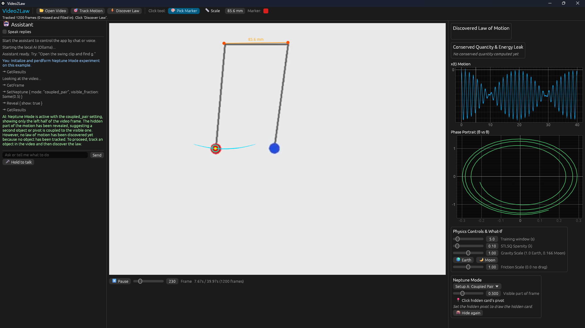
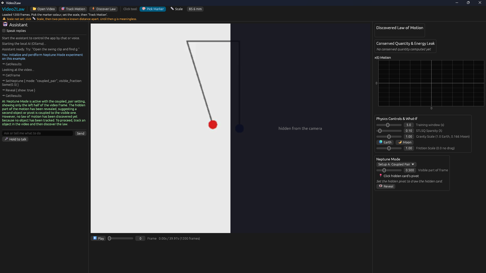

<div align="center">

# 🔭 Video2Law

**Film something moving. Get the law of physics behind it.**




*Neptune Mode: the camera only sees the red pendulum, yet the app works out that a hidden one is pulling on it, and draws it in blue.*

</div>

---

## ✨ What it does

Give it a short video of something swinging, and Video2Law:

| | Feature | How |
|---|---|---|
| 📐 | **Finds the law of motion**, e.g. θ̈ = −19.59·sin θ − 0.30·θ̇ → g = 9.79 m/s² | Sparse regression (STLSQ) |
| ⚡ | **Rediscovers energy** and measures how fast friction leaks it | SVD |
| 👻 | **Predicts the future** with a "ghost", plus what-ifs: *on the Moon? without friction?* | RK4 |
| 🪐 | **Neptune Mode** detects and rebuilds a hidden coupled pendulum or a hidden pushing hand | Hankel SVD + FFT |
| 🤖 | **AI assistant** (AI edition) runs the whole app by chat or voice and tracks objects by name | Local Qwen3 + Whisper |

No training data and no black box: every number comes from linear algebra you can follow step by step. The AI only presses the app's buttons; it never does the physics.

> **Why "Neptune"?** In 1846 astronomers noticed Uranus wobbling in a way Newton's laws couldn't explain, guessed a hidden planet was pulling on it, and found Neptune. This app does the same with a pendulum.

## 📸 Screenshots

| Before reveal | After reveal |
|---|---|
|  |  |

## 🧩 Two editions

| Edition | Folder | What you get |
|---|---|---|
| **NoAI** | `video2law-noai/` | The full physics app: open a video, click the marker colour and the scale, track, discover the law, energy + leak, ghost prediction with Moon/no-friction what-ifs, Neptune Mode. |
| **AI** | `video2law-ai/` | Everything above, plus a local AI assistant that operates the whole app by chat or voice, and **AI object tracking**: say "the glowing ball" and the vision model finds it, no sticker needed. Runs fully offline on the laptop's GPU (tested on a 4 GB GTX 1650). |

## ✅ Results (checked against a physics engine)

We filmed scenes from the Rapier physics engine so we knew the true answers in advance.

- **Law:** g = 9.79 m/s² (true 9.81); energy ½θ̇² − 19.50·cos θ; leak −0.30·θ̇²
- **Robustness (108 scenes):** g within 10% in 106, energy correct in 108, leak in 106
- **Ghost:** within 0.2 cm of the real object for 7 s; Moon what-if period × √6, as theory says
- **Neptune Mode:** hidden pendulum within 0.5 cm from half a cropped video; hidden hand within 1 cm
- **AI tracking:** within 2 px per keyframe

*Not yet tested on real phone footage: that's next.*

## 🚀 Build and run

Requirements: [Rust](https://rustup.rs) (stable, MSVC) and [ffmpeg](https://ffmpeg.org) on PATH (`ffmpeg -version`).

```powershell
cd video2law-noai;  cargo run --release -p app   # NoAI edition
cd video2law-ai;    cargo run --release -p app   # AI edition (needs runtime/, below)
cargo test -p engine                             # physics tests against Rapier ground truth
```

Open a clip from the `clips/` folder to try it.

<details>
<summary><b>AI edition: one-time runtime setup</b></summary>

The AI runs through [Ollama](https://ollama.com), found in a `runtime/` folder next to or above the .exe (override with `V2L_RUNTIME`). The app starts Ollama itself.

```powershell
# run from the repository folder
$env:OLLAMA_MODELS = "$PWD\runtime\models\ollama"
.\runtime\ollama\ollama.exe serve             # in one terminal
.\runtime\ollama\ollama.exe pull qwen3:4b-instruct
.\runtime\ollama\ollama.exe pull qwen3-vl:2b
```

Whisper (speech-to-text): put `model.safetensors`, `config.json` and `tokenizer.json` from Hugging Face `openai/whisper-base.en` in `runtime\models\whisper-base-en`.

Checks: `cargo run -p ai --example listen_check` (speech), `cargo run -p ai --example brain_check` (AI tracking + answers), `cargo run -p ai --example context_check` (a full request on a glowing-ball scene).

</details>

## 📁 Repository layout

```
Video2Law/
├─ README.md
├─ Photos/            ← screenshots
├─ video2law-noai/    ← NoAI edition (Cargo workspace: engine, app) + sample clips
└─ video2law-ai/      ← AI edition (Cargo workspace: engine, ai, app) + sample clips
```

`engine/` is pure maths with no GUI, `ai/` is the local assistant, and `app/` is the egui interface.

## 👥 Team: Millionth Iteration

Built in one day for the **Open Scientific Intelligence Hackathon 2026** by
**Arman Gulia** ([@armangulia29](https://github.com/armangulia29)) and **Vinayakan V**.
